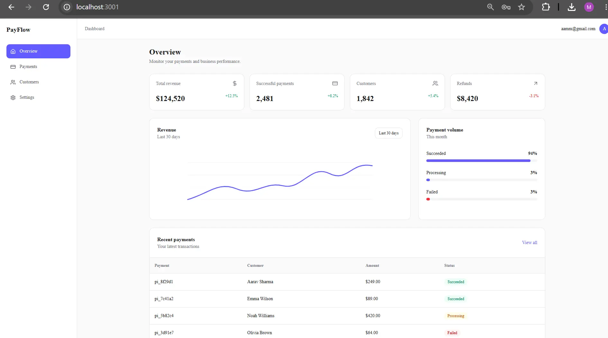

# PayFlow

**Payment Operations Dashboard**



PayFlow is a responsive payment operations dashboard for monitoring transactions, revenue and customers in one place. It is a frontend-only project built for portfolio and demonstration purposes.

## 🚀 Features

- Revenue monitoring with summary cards for key payment metrics
- Transaction list with search and status filtering
- Customer management views
- 8 routes: dashboard, payments, customers, profile, settings, and    login, signup and forgot-password screens 
- Responsive layout built from reusable components

## 📄 Pages

| Route | Page |
|---|---|
| `/` | Dashboard with revenue and payment overview |
| `/payments` | Transactions with search and status filtering |
| `/customers` | Customer management |
| `/profile` | User profile |
| `/settings` | Account and application settings |
| `/login` | Login screen |
| `/signup` | Sign-up screen |
| `/forgot-password` | Password reset screen |

## 🛠️ Technology Stack

| Layer | Technology |
|---|---|
| Framework | Next.js 16, React 19 |
| Language | TypeScript |
| Styling | Tailwind CSS 4, shadcn/ui |
| Icons | Lucide React |
| Linting | ESLint |

## ⚙️ Getting Started

**Prerequisites:** Node.js 20 or newer.

```
git clone https://github.com/mantu-kumar05/payflow.git
cd payflow
npm install
npm run dev
```

Open http://localhost:3000 in your browser.

### Other scripts

| Command | Description |
|---|---|
| `npm run build` | Creates a production build |
| `npm run start` | Runs the production build |
| `npm run lint` | Runs ESLint |

## 🔐 Development Note

PayFlow is a frontend demonstration. It does not connect to a real payment provider or process real transactions.

## 📄 License

This project is intended for educational, demonstration and portfolio use.